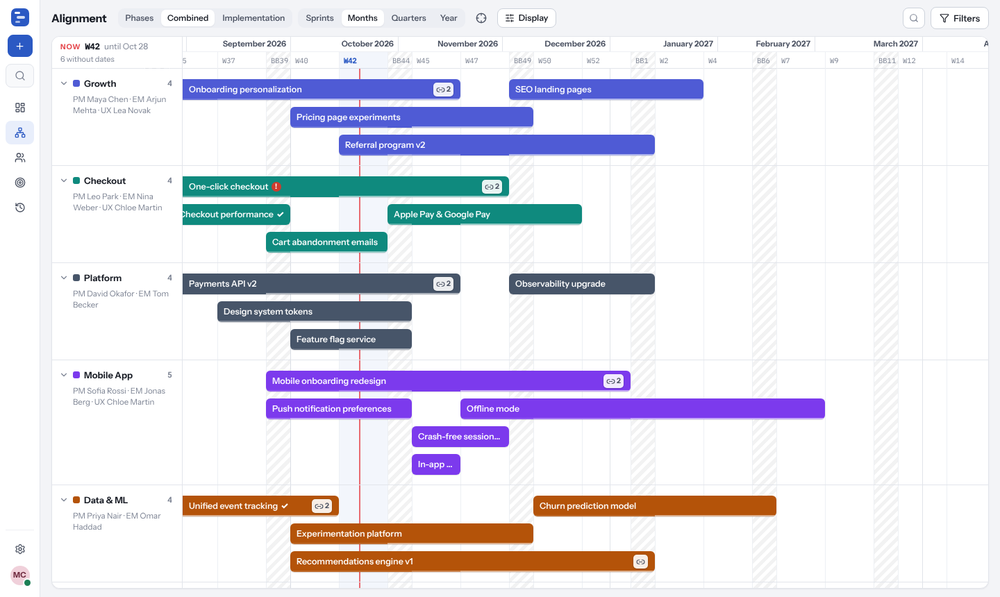
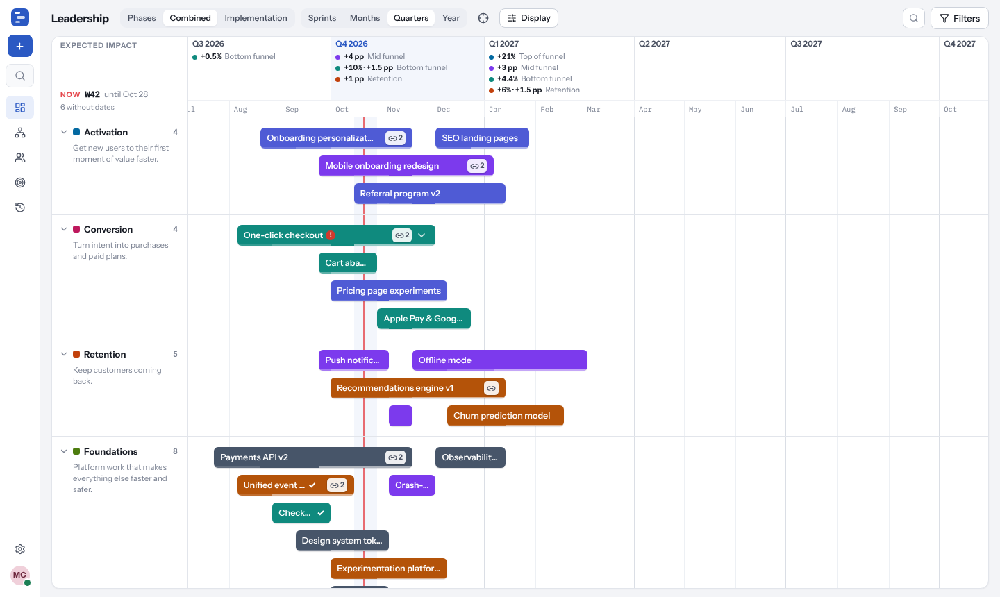
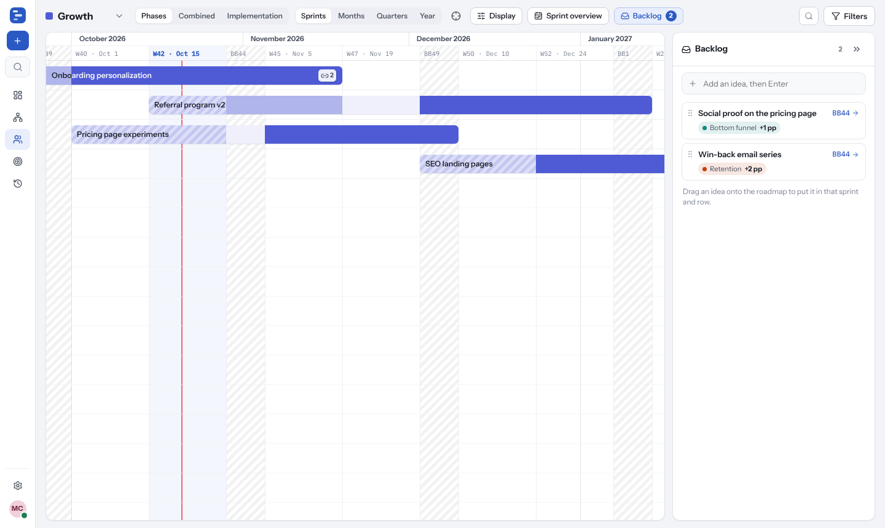
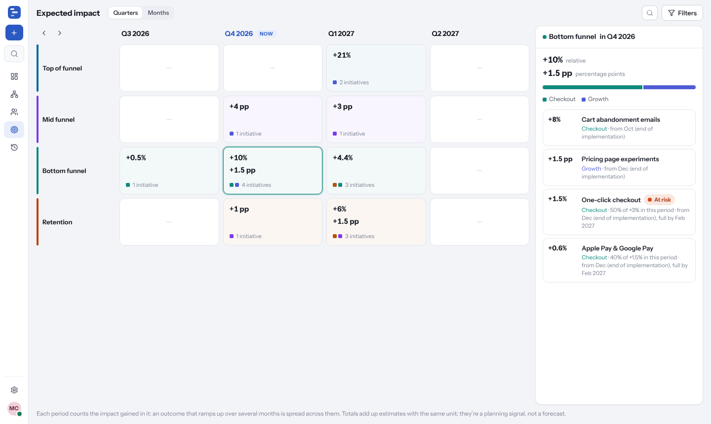
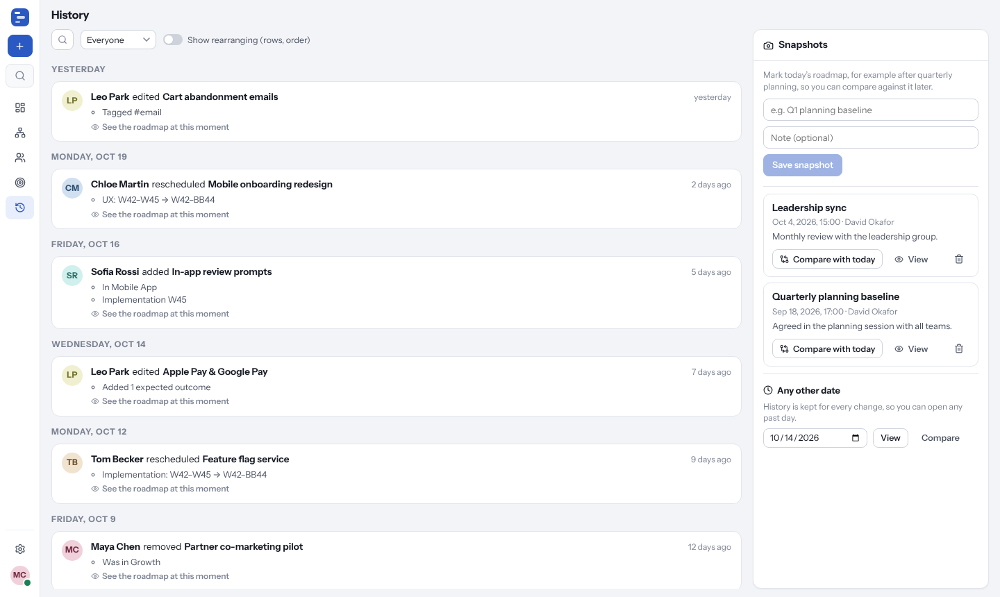
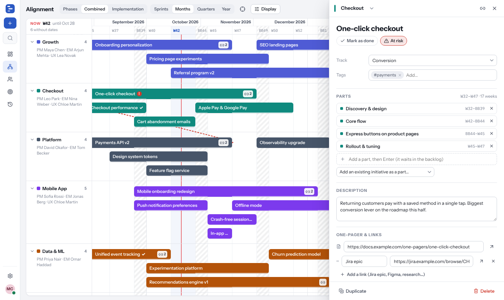

# Roadmap Anywhere

One shared roadmap for the whole company, with a different view for each audience:

| View | For | What it shows |
| --- | --- | --- |
| **Leadership** | Leadership group | The roadmap grouped by strategic bet (or team, funnel stage, tag, or not grouped at all), zoomed out to quarters; an initiative split into parts shows once. The header shows each quarter (or month, zoomed in) with the impact it's expected to gain per funnel stage, and the months (or sprints) below. Each bar with expected outcomes names them small under the initiative's name ("+3% Bottom funnel · +1 pp Retention"; an umbrella adds up its own and its parts'). |
| **Alignment** | Cross-team syncs | Every team on one timeline. Open an initiative to see its dependency arrows, or show them all from *Display*; red dashed ones land too late. |
| **Team** | Sprint planning | One team's initiatives (and the parts of bigger ones) on a free board, named inside the bar, with Discovery / UX / Implementation side by side. Put each on any row, several to a row when their dates don't clash (back-to-back ones keep a little space between them), and make a bar two rows high to fit a long name. Bars are pastel: initiatives on their own share a default colour, and the parts of each umbrella share a colour of their own, picked to stand apart from the other umbrellas. Change either with **Colour** in the details (on a part, it recolours its umbrella and all its parts). Group the rows by umbrella (a lane per umbrella; drag a bar into one to make it a part, or into "No umbrella" to make it its own initiative again), strategic bet, funnel stage or tag (none by default; an initiative with several tags appears under each). The team's owners (PM, EM, UX) sit next to its name. **Sprint overview** shows what's in each phase this sprint, what starts or ends, what others need from the team and what it needs from others. **Backlog** holds ideas that aren't on the roadmap yet: add one in a line, see which part of the funnel each would move, and drag it onto the roadmap (or send it to the next sprint). Both panels are closed until you open them. Tasks stay in Jira. |
| **Strategic bet** | A bet's owners and stakeholders | For a bet given *Own view* in Settings (it then has its own entry in the sidebar): a plain timeline with a row per umbrella, or per initiative without one, named on the left, with thin bars and no names in them. An umbrella is one bar, as in the leadership view; the chevron by its name opens it, and each part gets a line of its own under it, named on the left. Group the rows by team or tag under *Display*. Click a name to open it; drawing in an umbrella's row adds a part, and **N** adds an initiative to the bet. |
| **Impact** | Leadership, product | Expected outcomes rolled up by quarter (or month) × funnel stage ("what moves the bottom funnel in Q3, and which initiatives drive it"), with each team's share. Each period counts the impact gained in it, so an outcome that ramps up over a few months is spread across them. |
| **History** | Everyone | Every change, who made it and when. Snapshots (e.g. "Q3 planning baseline"), read-only time travel to any moment, and **compare with today**: dashed outlines show where things were, badges show slips (+2 sprints), new items and initiatives marked done or at risk. In both, expected impact reads *then → now* wherever it changed ("+3% → +5%"): in the Leadership header and under each bar's name, and in the Impact view's cells and driver cards. |

Every view can show phases **separately** (Discovery, UX and Implementation side by side in one bar, each in its own shade), **combined** into one bar, or **implementation only**. Names sit inside the bars; hover a bar for the full details.



<details>
<summary>More screenshots</summary>

**Leadership overview**


**Team view with the backlog open**


**Expected impact by quarter and funnel stage**


**History and snapshots**


**Editing an initiative**


</details>

## What an initiative holds

Name · team · strategic bet (the big bet it serves) · tags · two flags, **done** and **at risk** (the roadmap itself shows where everything else stands) · short description · Discovery, UX and Implementation dates (two lines in the details: pick a phase, then its first and last sprint in one control; a new phase starts as one sprint) · one-pager link · other links (Jira epic, Figma, research…) · expected outcomes (funnel stage, expected change in % / pp / absolute, the month it lands, and an optional ramp-up such as 50% in July, 85% in August, full from September) · dependencies on other initiatives or on a team (with *not agreed / agreed / delivered*), plus "needed by" in reverse.

Ownership sits with the team: each team's PM, EM and UX designer (set in **Settings → Teams**) own everything on its roadmap.

### One initiative, several parts

Management often reads one initiative ("One-click checkout") where the team plans several smaller pieces: discovery, iterations, releases, a parallel app stream. Make those pieces **parts** of one umbrella initiative:

- In a part's details, **Part of** links it to an umbrella, or creates a new one named after it (the text before a colon is suggested, and its expected outcomes move up to the umbrella). An umbrella's details list its parts, with a quick add (new parts wait in the backlog) and a way to add existing initiatives. **Split into parts** turns a standalone initiative's dates into its first part.
- The umbrella holds what's shared (title, expected outcomes, one-pager, strategic bet). Its dates are its parts': from the first one's start to the last one's end, phase by phase. Parts keep their own dates, rows, links and flags.
- Details are cross-linked. A part shows its umbrella's expected outcomes ("Shared by One-click checkout") and can add its own; the umbrella shows its parts' outcomes ("From its parts"). Each outcome still counts once in the Impact view, on the initiative that holds it. The one-pager belongs to the umbrella: a part's One-pager field shows and edits it, and the link button on a part's bar opens it. Linking a part that had its own one-pager moves it up to the umbrella (or, if the umbrella has one, keeps it as one of the part's links).
- **Leadership, Alignment and Impact** show the umbrella as one initiative. Dragging it (or ←/→ when it's open) moves every part by the same number of sprints. A part's dependency arrows start or end at its umbrella, while whether one lands too late still depends on the part's own dates.
- In **Leadership and Alignment**, the chevron at the end of an umbrella's bar opens that one umbrella (or open them all with *Display* → *Expand all*): it stays on its line, its parts appear in new lines right under it (in a light box), and the lines below move down to make room. Parts can be moved and resized in time there. Each view remembers which umbrellas are open; click again to close.
- **The team view** shows the parts, each named in two lines: its umbrella small and quiet on top ("One-click checkout"), its own name below ("Core flow"); the umbrella line is left out when the name already starts with it. Hovering a part lights up the others. Parts can belong to other teams too.
- Deleting an umbrella keeps its parts as initiatives of their own. One level only: parts don't have parts.

Roadmaps from earlier versions open as they are: initiatives that were *idea* or *in progress* read as on track (done and at risk stay), and stars, per-initiative owners, outcome metrics and confidence are kept in the data but no longer shown.

## Working with it

- The **sidebar** holds the views, your teams, search, undo/redo and settings (new initiatives are drawn right on the roadmap, see Quick add below, or added with **N**). It rests as a slim icon rail and opens over the roadmap when you hover it; the pin next to the name keeps it open. Each view's controls sit in one row; grouping, colours and toggles are under **Display**.
- **Drag** a bar to reschedule it; it snaps to whole sprints. Drag an **edge** to change the start or end. **⇧ + drag** a phase to move all phases together.
- **Drag up or down** to move an initiative to another team or strategic bet. In the team view, drop it on any row (several can share one; if the dates clash it takes the next free row), or between two rows to add a row there.
- **Drag a bar's bottom edge** down to make it two rows high, with room for a long name; drag it up for one row.
- **Quick add:** drag across an empty part of a lane (in the team view, any row, including the open rows below) to draw an initiative over those sprints, type its name and press **Enter** (**⇧ + Enter** also opens its details, **Esc** cancels). Double-click a lane for a one-sprint initiative.
- **⌥/Alt + drag** empty space, or drag the date header, to scroll around. **⌘/Ctrl + scroll** (or pinch) zooms around the pointer.
- The **link button** on a bar opens its one-pager right away (or lists its links when it has several).
- **⌘/Ctrl K** searches initiatives (by name, description, team, strategic bet, umbrella or tag; each result shows its umbrella and tags), teams and actions. **N** adds an initiative. **⌘/Ctrl Z** undoes, **⌘/Ctrl ⇧ Z** redoes. **← / →** moves the open initiative by a sprint. **?** lists all shortcuts.
- Changes save as you go and appear for everyone else instantly. Each person's own view settings (zoom, grouping, filters, theme) are remembered in their browser.

## Sprints

The calendar follows a repeating cadence that is set up for **2 weeks + 2 weeks + 1 week "Brilliant Basics", starting on Thursdays**, with a cycle starting on Thursday 1 October 2026. Sprints are named after the ISO week they start in: **W40** (Oct 1–14), **W42** (Oct 15–28), **BB44** (Oct 29 – Nov 4), then W45, W47, BB49… In **Settings → Sprint cadence** you can change the cycle start date, switch to running numbers (S25, S26…), and set the length, name and prefix of each sprint type and which types are shaded on the timeline. All dates on the roadmap snap to these sprints.

Roadmaps made with earlier versions were on a built-in calendar that was off. On start, the server moves an untouched earlier calendar to this one (a calendar changed in Settings is left alone) and records it in History. The cycle that started Oct 15 had its BB weeks a sprint late: dates on its sprint edges that now fall mid-sprint move to the next edge, so no initiative ends earlier and phases that met still meet.

## History, snapshots and time travel

Every change is stored with the full "before" and "after" of what changed. That gives you:

- an **activity feed** in plain language ("Tom Becker rescheduled Payments API v2 — Implementation: S22–S26 → S22–S28 (+2 sprints)"),
- **any past moment, read-only**: pick a change, a snapshot or a date and the whole app shows the roadmap as it was,
- **compare with today** from any snapshot or date,
- expected impact **then → now**: while you view an older moment or compare with one, the Leadership header, the outcome line under each bar and the Impact view show the older figure next to today's wherever they differ ("+3% → +5%", "+2% → —" for impact no longer expected there),
- **restore** an initiative to any earlier version from its *Activity* section, and **undo/redo** for your own recent changes.

Quick successive edits to the same initiative by the same person (within 10 minutes) are merged into one history entry, so dragging a bar around while deciding doesn't flood the log. Edits are never merged across a snapshot, so a snapshot always shows exactly what people saw.

## Running it

Requires **Node.js 22.18 or newer** (it runs the TypeScript server directly and uses Node's built-in SQLite; there are no native dependencies).

```bash
npm install
npm run dev          # http://localhost:3000, with hot reload
npm run dev:sync     # same, and pulls new commits from GitHub every 15 s while you test
```

Production:

```bash
npm run build        # builds the browser app into dist/client
npm start            # serves the app and the API on $PORT (default 3000)
```

Or with Docker:

```bash
docker compose up -d --build
```

The first start creates `data/roadmap.db` (or `/data/roadmap.db` in Docker) with an example roadmap so people can explore. Set `SEED=empty` before the first start for a blank one, or delete the example initiatives later.

### Configuration

| Variable | Default | |
| --- | --- | --- |
| `PORT` | `3000` | Port to listen on. |
| `HOST` | `0.0.0.0` | Interface to bind. |
| `DATA_DIR` | `./data` | Where the SQLite database lives. Back this up. |
| `SEED` | `demo` | `demo` fills a new database with example data; `empty` starts blank. Only used when the database is empty. |
| `AUTH_HEADER` | (unset) | Name of a header set by your sign-in proxy that carries the user's identity, e.g. `X-Forwarded-Email`. See below. |

### Sign-in

The app has no passwords of its own. Put it behind your company's single sign-on proxy (for example [oauth2-proxy](https://oauth2-proxy.github.io/oauth2-proxy/) with Google Workspace or Okta, Cloudflare Access, or Google IAP) and set `AUTH_HEADER` to the header that proxy adds:

| Proxy | Header |
| --- | --- |
| oauth2-proxy | `X-Forwarded-Email` (or `X-Auth-Request-Email`) |
| Cloudflare Access | `Cf-Access-Authenticated-User-Email` |
| Google IAP | `X-Goog-Authenticated-User-Email` |

With `AUTH_HEADER` set, requests without the header are refused and every change in History carries the signed-in person's email. Make sure the app is only reachable through the proxy.

Without `AUTH_HEADER`, people type their name on first visit. That's fine for a trial on a private network, but anyone who can reach the URL can edit.

### Backups

Everything lives in one SQLite file, `roadmap.db`. Back up the `DATA_DIR` folder, ideally with `sqlite3 roadmap.db ".backup backup.db"` while the app runs. **Settings → Data → Export JSON** downloads the current roadmap and snapshot list; **Import JSON** replaces the roadmap with a file's contents (recorded in History like any other change).

### Demo build

`npm run build:demo` produces `dist/demo/roadmap-demo.html`, a single self-contained file with example data that keeps changes in the viewer's browser. Useful for showing the tool to people before it's deployed.

## Development

```bash
npm test             # unit tests (sprint calendar, history engine, impact roll-up) and API tests
npm run typecheck
```

```
src/shared   domain model shared by server and browser: types, sprint calendar, history engine, diff, impact, example data
src/server   Express API, live updates (server-sent events), SQLite storage
src/client   React app: views, the timeline (layout, drag and drop), item editor, store
```

The server keeps the roadmap in memory and writes every change to SQLite in a transaction, together with its history row. The browser applies changes immediately and sends them to the server, which broadcasts them to everyone else over server-sent events. Undo is the inverse change, so it's recorded in History like any other edit.

Working on the code (including with Claude): `CLAUDE.md` has the workflow, commands, glossary and gotchas; `docs/ARCHITECTURE.md` explains how the parts fit together; `docs/DECISIONS.md` records the product decisions made so far.

## Ideas for later

See [BACKLOG.md](BACKLOG.md).
